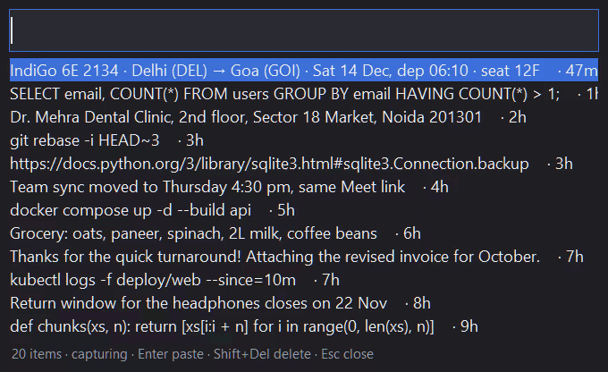

# clipmind

[](https://github.com/NAMAN-VERMA-02/clipmind/actions/workflows/ci.yml)


Clipboard history for Windows that you search by meaning. It refuses to store secrets, keeps history encrypted behind Windows Hello, and contains no network code.



*The real popup and search code running over a made-up history (`python scripts/demo.py`). The queries in the GIF share no words with what they find. Not every query works this well: see [search quality](#search-quality).*

## Why

Windows' own clipboard history (Win+V) keeps everything you copy, unfiltered: passwords, OTPs, card numbers, API keys. Most clipboard managers do the same, store it in plain files, and only let you search for exact words. clipmind is built the other way round: decide what must never be kept first, then make the rest easy to find.

## What it does

- **Search by meaning**: press **Win+Alt+V**, type what you remember ("plane ticket", "tooth doctor"). A small static embedding model ([potion-base-8M](https://huggingface.co/minishlab/potion-base-8M)) is combined with keyword matching. It runs locally on the CPU.
- **Enter** pastes into the window you were in; **Shift+Del** deletes the item; **Ctrl+P** pauses capture; **Esc** closes.
- Items expire after **7 days**. History is capped at **10,000** items, oldest first.
- Tray icon: pause, lock, wipe all, quit. `clipmind autostart on` starts it with Windows.

## Security in six points

1. **Secrets are never stored.** A clip is dropped when it comes from a password manager (detected by the clipboard formats password managers set, checked *before* the text is read), from a blocklisted app (password managers, Phone Link's OTP copy, authenticators), from a private browser window or a banking site, or when its content looks like a private key, JWT, API key, token, password, OTP, card number (Luhn), Aadhaar (Verhoeff) or PAN.
2. **Auto-clear quarantine.** New clips wait in RAM for 120 s before reaching disk. If the clipboard is cleared in that window, which is what password managers do after you paste, the clip is thrown away.
3. **Encrypted at rest, key held by Windows Hello.** Each item is a sealed box (X25519 + AES-256-GCM). The private key is wrapped by a Windows Hello signature and kept in Credential Manager, never in a file. Only ciphertext and an expiry hour reach disk.
4. **Locked by default.** While locked, the background process holds only the public key: it can add to history but **cannot read it**. It locks after 10 minutes idle and when Windows locks or sleeps. Unlocking needs Hello (PIN, face or fingerprint).
5. **No network code.** A test bans network modules from the package, another checks that no HTTP client is among the dependencies, and the whole test suite runs with sockets blocked. There's no telemetry. Logs hold decisions and lengths, never text.
6. **Deleting means deleted.** SQLite `secure_delete`, no WAL. Wipe-all removes every row and then destroys the key, so any leftover ciphertext becomes unreadable.

What it does **not** protect against (malware running as you while unlocked, admins, memory forensics, and more) is spelled out in [THREAT_MODEL.md](THREAT_MODEL.md).

## Real numbers

All numbers below come from the scripts in [`eval/`](eval/) and are committed as JSON in [`eval/results/`](eval/results/), together with the date, git SHA and machine. CI re-runs the filter and search evals on every PR and fails if they regress. Nothing here was tuned on the data it is measured on, except where a row says so.

**Source labels:** *independent* = real material from a source clipmind didn't write; *synthetic* = generated to a format spec; *hand-written* = written by this project.

### Secret filters: how many secrets get through

`python eval/filters_eval.py`: a lower miss rate is better.

| Secret type | Source | Samples | Missed |
|---|---|---:|---:|
| Private keys (RSA/EC/Ed25519/DSA in PEM, PKCS#8, OpenSSH, encrypted; `ssh-keygen`) | independent: minted by `cryptography` and `ssh-keygen` | 27 | **0%** |
| JWTs (HS/RS/ES/EdDSA, really signed) | independent: signed with real keys | 60 | **0%** |
| Card numbers | independent: 187 published test cards (Stripe, Adyen, Razorpay) × 4 formats | 748 | **1.1%** (2 of 187 numbers: a UATP card and a 19-digit UnionPay) |
| Aadhaar | synthetic (Verhoeff-valid) | 300 | **0%** |
| PAN | synthetic (valid format) | 300 | **0%** |
| OTP: SMS/email messages | hand-written, *after* the filters existed | 50 | **14%** |
| OTP: bare 6-digit code | synthetic | 200 | 0% |
| API keys | independent: [detect-secrets](https://github.com/Yelp/detect-secrets) test fixtures, 16 vendors | 70 | **44%** ([#11](https://github.com/NAMAN-VERMA-02/clipmind/issues/11)) |
| Random tokens (alnum-32, base64, urlsafe) | synthetic | 300 | 3.3% |
| Random tokens: 64-char hex | synthetic | 100 | 100% (kept by design: hex is also every SHA-256 and git hash) |
| Passwords from a generator (12–20 chars) | synthetic | 1,000 | **12%** |
| Passwords people choose (SecLists top 1,000) | independent | 1,000 | **96%** |
| Diceware passphrases | synthetic (EFF wordlist) | 500 | **100%** |

The content filter is a backstop for passwords, not the defence: `hunter2` and `correct horse battery staple` look like ordinary text. The defence is everything that runs before it: password-manager formats, the app blocklist, private-window detection and the auto-clear quarantine.

### Secret filters: how much safe text gets dropped

| Safe text | Source | Samples | Wrongly dropped |
|---|---|---:|---:|
| Held-out near-misses (order IDs, IMEIs, public keys, UUIDs, code that mentions passwords…) | hand-written *before* the filters, run once | 392 | **3.3%** ([#9](https://github.com/NAMAN-VERMA-02/clipmind/issues/9), [#10](https://github.com/NAMAN-VERMA-02/clipmind/issues/10)) |
| CPython standard-library code, 1–5 line snippets | independent | 4,000 | **0.8%** |
| Python documentation paragraphs | independent | 1,000 | **0%** |

### Auto-clear quarantine

The real capture code runs on a simulated clock, with the clipboard cleared after each password manager's delay:

| KeePassXC / KeePass default | Bitwarden 10 s – 2 min | 1Password 90 s | Bitwarden 5 min |
|---|---|---|---|
| discarded | discarded | discarded | **stored**: raise `quarantine_seconds` to 300 if you use it |

### Search quality

`python eval/search_eval.py`: 100 queries, each looking for one of 150 hand-written target clips hidden among 10,000 items. The other 9,850 items are CPython code and docs. Copy times are random, so recency can't help.

| Model | Ranking | Found in top 5 | 95% CI |
|---|---|---:|---:|
| potion-base-8M (default) | hybrid (shipped) | **48%** | 38–58% |
| potion-base-8M | meaning only | 50% | 40–60% |
| potion-base-8M | keywords only | 31% | 23–41% |
| potion-retrieval-32M | hybrid | 44% | 35–54% |
| potion-retrieval-32M | meaning only | 53% | 43–62% |

By query type (default model, hybrid): **keyword queries 100%** (n=30), **vague 35%** (n=31), **paraphrases 18%** (n=39).

The confidence intervals overlap, so this eval can't tell the rankings or the two models apart. The honest summary: if you remember a word that was in the clip, clipmind finds it. If you only remember what it was *about*, it finds it about a third of the time. "When is my flight" doesn't find the booking in the demo, but "plane ticket" does. Caveats:
- the 100 queries were written by Claude, who could see the targets;
- 50 blind queries written by Naman (T101–T150) are still to come;
- the distractors are code and docs, not a real clipboard.

### Speed and memory

`python eval/bench.py` on a laptop: Intel i3-1215U, 8 logical cores, 7.7 GB RAM, Windows 11, Python 3.12.10. Measured 2026-11-10 at 10,000 items, through clipmind's real code paths, with Windows Hello replaced by a fixed signer. Each model ran twice, once first and once second, and the medians are shown. The machine was 37–68% busy with other work, and run-to-run spread was up to 3×.

| | potion-base-8M (default) | potion-retrieval-32M |
|---|---:|---:|
| Search, median / p95 | **26 / 50 ms** | 24 / 48 ms |
| Unlock 10k items (after the Hello prompt) | **1.8 s** (runs: 1.4, 2.2) | 2.5 s (runs: 1.3, 3.7) |
| Store one clip (filter + embed + encrypt + write), median / p95 | 31 / 92 ms | 31 / 91 ms |
| Start-up to ready | 1.5 s | 1.6 s |
| RAM (USS), locked | **32 MB** | 36 MB |
| RAM (USS), unlocked with 10k items | **62 MB** | 86 MB |
| Disk per item | 1.0 KB | 1.4 KB |

## Install

Needs Windows 10 or 11 with **Windows Hello set up** (a PIN is enough), and Python 3.12+.

```bash
git clone https://github.com/NAMAN-VERMA-02/clipmind
cd clipmind
python -m venv .venv
.venv\Scripts\activate
pip install .
python scripts/fetch_model.py
python -m clipmind run
```

`fetch_model.py` downloads the model at a pinned revision and checks its SHA-256. It is the only networked code in the repo and lives outside the package. Then turn off Windows' own clipboard history (Settings → System → Clipboard), or every copy is still kept there unfiltered. clipmind warns you at start if it's on.

## Usage

```bash
python -m clipmind run              # start (tray icon); Win+Alt+V opens the popup
python -m clipmind status           # data folder, item count, key and model state (no unlock needed)
python -m clipmind wipe             # delete all history and destroy the key
python -m clipmind autostart on     # start with Windows (off to undo)
```

## Configuration

Optional `%APPDATA%\clipmind\config.json`. Lists are **added** to the built-in ones, never replace them, so a config edit can't silently drop a password manager from the blocklist.

```json
{
  "hotkey": "ctrl+shift+v",
  "ttl_days": 3,
  "idle_lock_minutes": 5,
  "quarantine_seconds": 300,
  "blocked_apps": ["mybank.exe"],
  "blocked_title_keywords": ["Payroll"]
}
```

## Limitations

- **Text only.** Images, files and rich text aren't captured.
- **The real Windows Hello path is tested by hand, not in CI.** CI can't show a Hello prompt, so the tests and the bench use a stand-in signer. `pytest -m hello -s` exercises the real prompts. It passed on the author's laptop on 2026-11-10 (the same key unwrapped twice), and a cancelled prompt in a later run found [#13](https://github.com/NAMAN-VERMA-02/clipmind/issues/13), now fixed. Other devices (fingerprint, face, no TPM) haven't been tried.
- **Firefox and Brave private windows** are detected from their known window titles, not verified live. Edge InPrivate and Chrome Incognito were verified.
- **Paraphrase search is weak** (see above). Keyword search is reliable.
- **Losing Hello loses history.** A PIN reset or a TPM clear makes old history unreadable. With 7-day expiry that's accepted.
- Nothing expires while clipmind isn't running. Expiry runs first at every start.

## Development

```bash
pip install --require-hashes -r requirements-dev.txt
pip install --no-deps -e .
ruff check .
pytest                     # sockets are blocked for the whole run
python eval/filters_eval.py
```

CI runs lint, the tests, both evals (with a regression check) and `pip-audit` on `windows-latest`, from a hash-pinned lockfile with SHA-pinned Actions. Security issues: see [SECURITY.md](SECURITY.md).

## License

[MIT](LICENSE) © 2026 Naman Verma
